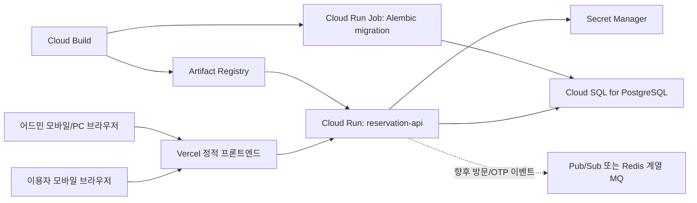
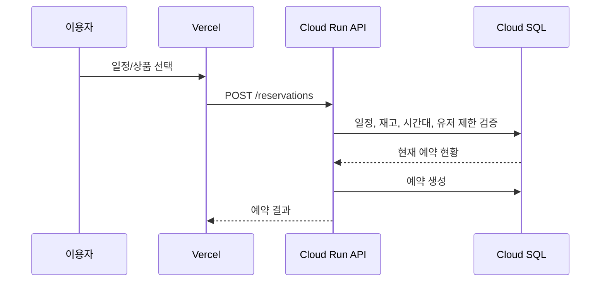
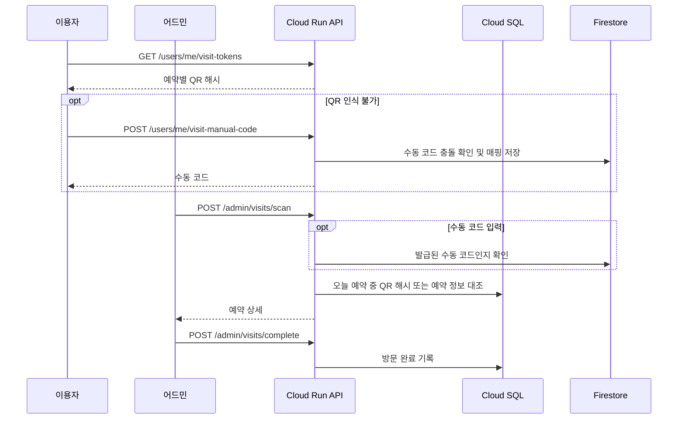
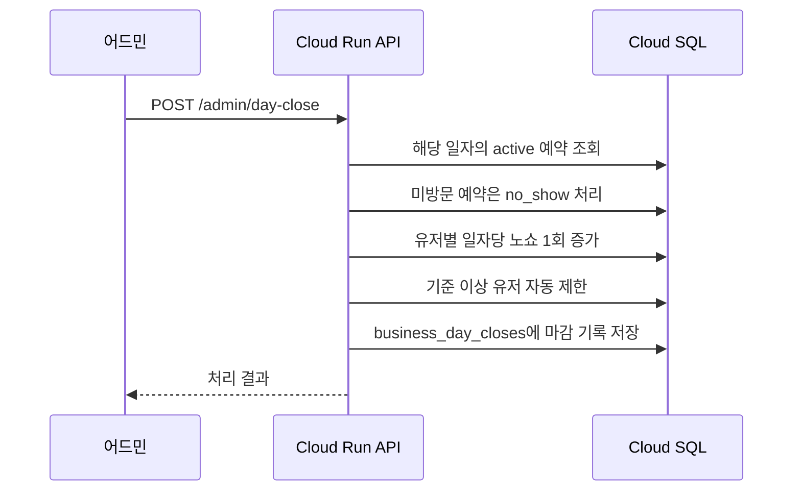
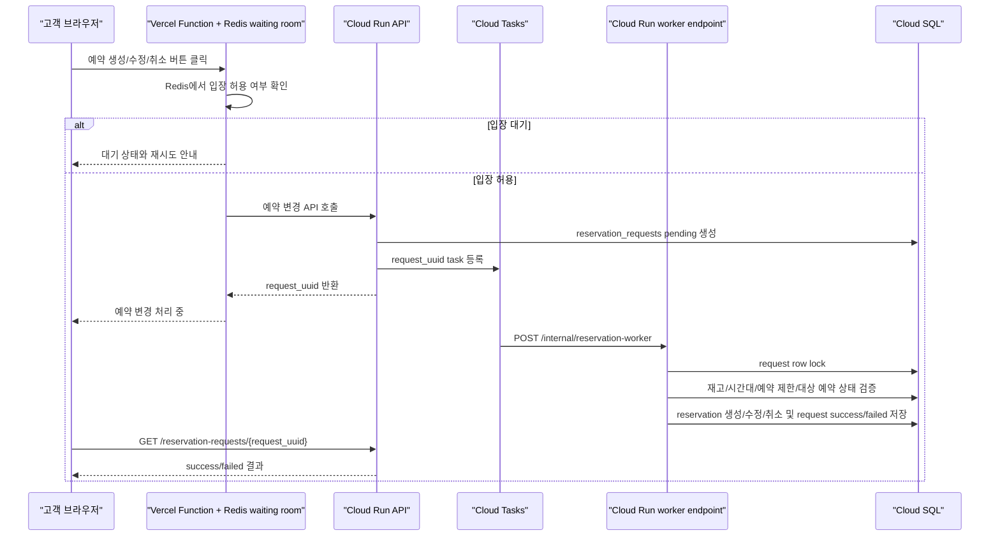
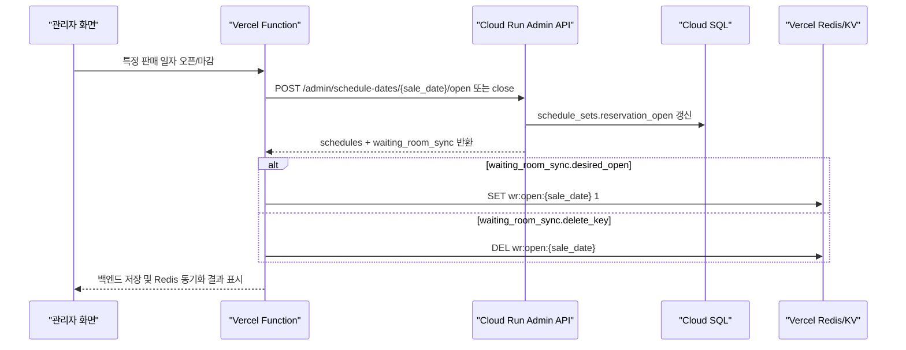

# 서비스 아키텍처

이 문서는 기존 PC 단독 실행형 예약 시스템을 Cloud Run, Cloud SQL, Secret Manager, Vercel 기반 구조로 옮겼을 때의 전체 그림을 설명합니다.

## 목표 구조

## 구성 요소

### Vercel 프론트엔드

- 정적 HTML, CSS, JavaScript를 배포합니다.
- 화면 구성은 `/docs/frontend.md`를 기준으로 별도 구현합니다.
- API 주소는 Vercel 환경변수 `NEXT_PUBLIC_API_BASE_URL` 또는 정적 JS 설정값으로 관리합니다.

### Cloud Run 백엔드

- Python FastAPI 기반입니다.
- 모든 기능은 API 엔드포인트로 노출됩니다.
- `IS_DEV_MODE=True`일 때만 `/swagger`, `/redoc`, `/openapi.json`이 열립니다.
- 운영에서는 Swagger를 닫아 두고, 문서화된 API 명세를 기준으로 프론트엔드가 연동합니다.

### Cloud SQL for PostgreSQL

- 기존 Excel 파일 DB 역할을 대체합니다.
- Alembic으로 스키마 버전을 관리합니다.
- 이용자 테이블에는 내부 순번 `id`, 카카오 식별자 `kakao_id`, 닉네임 `nickname`, TOTP용 별도 UUID `uuid`가 모두 들어갑니다.

### Secret Manager

다음 값은 Secret Manager에서 Cloud Run 환경변수로 주입합니다.

- `DATABASE_URL`
- `SECRET_KEY`
- `OTP_SECRET_KEY`
- `ADMIN_ID`
- `ADMIN_PASSWORD`
- `KAKAO_REST_API_KEY`
- `KAKAO_CLIENT_SECRET`

### OTP와 메시지 버스

- 현재 OTP는 서버 시간 기반 TOTP counter를 사용합니다.
- QR 값은 `{유저 UUID}:{예약 UUID}:{counter}`를 HMAC 해시한 값입니다.
- 기본 QR 해시는 `md5`, 수동 코드는 `sha1` 앞 12자리입니다.
- `OTP_QR_HASH_ALGORITHM`, `OTP_MANUAL_HASH_ALGORITHM`, `OTP_MANUAL_CODE_LENGTH`로 교체 가능합니다.
- QR 표시는 stateless 계산만 사용합니다.
- 수동 코드는 QR 인식이 어려워 별도 발급 API를 호출할 때만 Firestore에 충돌 방지 매핑을 저장합니다.
- 메시지 버스는 현재 `none` 기본값입니다.
- 향후 `MESSAGE_BUS_BACKEND=pubsub`, `VISIT_EVENT_TOPIC=projects/.../topics/...`를 주면 방문 완료/하루 종료 이벤트를 Pub/Sub로 흘릴 수 있습니다.

## 데이터 흐름

### 예약

### 방문 확인

### 하루 일정 종료

서버리스 운영에서는 서버 시작 시 지난 날짜를 자동 마감하지 않습니다. 어드민 메인 화면은 `GET /admin/day-close/pending`으로 마감 기록이 없는 지난 영업일을 보여주고, 관리자가 날짜별로 확인한 뒤 `POST /admin/day-close`를 호출합니다.

## 동시성 기준

- Cloud Run은 요청을 동시에 처리할 수 있으므로 Excel 파일 잠금 방식은 사용하지 않습니다.
- 예약 생성 API는 DB transaction과 row lock을 전제로 설계했습니다.
- PostgreSQL에서는 `SELECT ... FOR UPDATE`가 사용자 중복 예약, 재고, 시간대 정원, 일정 상태를 동시에 수정하는 경쟁 상황을 막습니다.
- 같은 사용자가 같은 날짜 예약 버튼을 동시에 여러 번 눌러도 사용자 행을 먼저 잠그고 기존 예약을 재확인합니다.
- 같은 상품이나 같은 방문 시간대에 여러 사용자가 동시에 예약해도 상품 행과 시간대 행을 잠근 뒤 남은 수량을 다시 계산합니다.
- 방문 완료와 하루 일정 종료도 예약 행을 잠근 뒤 상태를 바꾸므로 같은 예약이 방문 완료와 노쇼로 동시에 처리되지 않도록 설계했습니다.
- 영업일 마감은 `business_day_closes.sale_date` unique 제약으로 중복 마감을 막습니다.
- 프론트엔드 검증은 사용자 편의용이고, 최종 판단은 항상 API와 DB transaction에서 수행합니다.

## rev_003 예약 피크 완충 구조

예약 생성/수정/취소는 피크 시간에 다음 구조를 사용할 수 있습니다.

역할 분리:

- Vercel Redis waiting room은 Cloud Run과 Cloud SQL에 동시에 들어오는 요청 수를 줄입니다.
- Cloud Tasks는 접수된 예약 변경 요청을 정해진 속도로 worker에 전달합니다.
- Cloud SQL transaction은 최종 재고, 시간대 정원, 중복 예약 정합성을 보장합니다.
- Cloud Tasks는 재시도될 수 있으므로 worker는 `reservation_requests.uuid`와 상태값으로 멱등성을 보장합니다.

## rev_004 판매 일자 오픈/마감 동기화

판매 일자 오픈/마감 시 Vercel Redis waiting room 상태는 Vercel Function이 동기화합니다. Cloud Run은 Redis를 직접 호출하지 않고, 응답에 `waiting_room_sync` 지시만 포함합니다.

이 구조에서는 SQL의 일정 오픈/마감 상태가 원본이고, Redis `wr:open:{sale_date}`는 피크 시간 부하를 줄이기 위한 캐시성 운영 스위치입니다.
