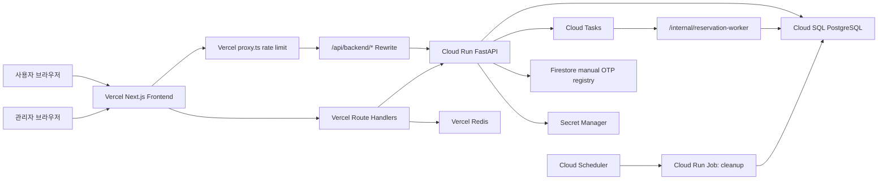
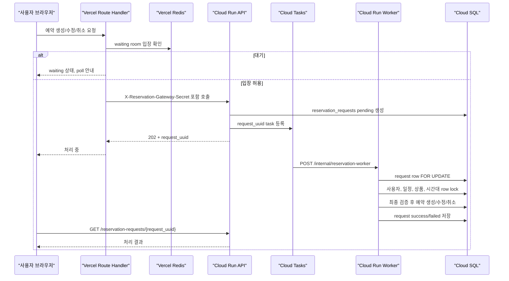

# reservation.io 백엔드 시스템 기준 문서

작성일: 2026-06-22  
대상 저장소: `pokecardreservation.io`  
대상 서비스: `reservation-api`  
기준 프론트엔드 문서: `D:/SynologyDrive/_Main Archive/_Productivity Workflow/reservation.io-frontend/docs/system_0622.md`

이 문서는 지금까지 설계하고 구현한 reservation.io 백엔드 시스템을 한 문서만 보고 다시 구현할 수 있도록 정리한 기술 기준 문서입니다. 프론트엔드 저장소의 `system_0622.md`를 분석해 Vercel, Redis waiting room, Next.js route handler, Cloud Run API 연동 방식까지 함께 반영했습니다.

## 1. 시스템 목표

reservation.io는 한정 판매 상품 예약을 모바일 중심으로 처리하는 예약 시스템입니다.

사용자는 카카오 로그인 후 판매 날짜, 판매 일정, 상품, 방문 시간을 선택해 예약합니다. 관리자는 판매 일정 생성, 예약 현황 조회, 방문 확인, 노쇼 처리, 예약 제한, 안내문과 예약 동의 메시지 관리를 수행합니다.

현재 목표 구조는 다음과 같습니다.

- 백엔드: Python FastAPI, Cloud Run, Cloud SQL, Cloud Tasks, Firestore
- 프론트엔드: Next.js App Router, Vercel 정적/서버 함수 배포
- 피크 완충: Vercel Redis waiting room
- 최종 정합성: Cloud SQL transaction과 row lock
- 수동 방문 코드 충돌 방지: Firestore
- 배포: Cloud Build, Artifact Registry, Cloud Run Job 기반 Alembic migration

## 2. 전체 아키텍처



경로별 책임은 다음과 같습니다.

| 흐름 | 진입점 | 백엔드 책임 |
| --- | --- | --- |
| 일반 조회 | `/api/backend/*` Vercel rewrite | 인증, 데이터 조회, 사용자 표시용 응답 |
| 예약 생성 | `/api/reservation-requests` Vercel route handler | `reservation_requests` 접수, Cloud Tasks 등록 |
| 예약 수정 | `/api/reservations/{reservation_uuid}` PATCH Vercel route handler | 변경 요청 접수, worker 처리 |
| 예약 취소 | `/api/reservations/{reservation_uuid}` DELETE Vercel route handler | 취소 요청 접수, worker 처리 |
| 판매일 열기/닫기 | `/api/admin/schedule-dates/{sale_date}/{open|close}` Vercel route handler | SQL 상태 변경, Redis 동기화 지시 반환 |
| 방문 QR | `/api/backend/users/me/visit-tokens` | 오늘 예약의 QR 해시 계산 |
| 수동 방문 코드 | `/api/backend/users/me/visit-manual-code` | Firestore 충돌 확인 후 코드 발급 |
| 내부 예약 worker | Cloud Tasks -> `/internal/reservation-worker` | SQL transaction 안에서 최종 확정 |

## 3. 주요 파일 지도

| 경로 | 역할 |
| --- | --- |
| `reservation_api/main.py` | FastAPI 앱, 라우팅, 인증 dependency, 운영 설정 검증 |
| `reservation_api/config.py` | `.env`/Cloud Run 환경변수 로딩 |
| `reservation_api/security.py` | Bearer token 생성과 검증 |
| `reservation_api/models.py` | SQLAlchemy ORM 모델 |
| `reservation_api/schemas.py` | Pydantic 요청/응답 스키마 |
| `reservation_api/reservation_service.py` | 예약 생성/수정/취소 transaction 처리 |
| `reservation_api/reservation_queue.py` | Cloud Tasks 등록 |
| `reservation_api/manual_code_registry.py` | memory/Firestore 수동 코드 저장소 |
| `reservation_api/otp.py` | TOTP counter, QR 해시, 수동 코드 생성 |
| `reservation_api/read_models.py` | API 응답 조립, 남은 재고/자리 계산 |
| `reservation_api/timezone.py` | 서버 표시 시간대 기준 날짜 계산 |
| `reservation_api/maintenance.py` | 예약 요청 cleanup 같은 운영 작업 |
| `alembic/versions/*` | DB schema migration |
| `cloudbuild.yaml` | 이미지 빌드, migration job, Cloud Run 배포 |
| `static/personal.md` | 개인정보 처리방침 Markdown |
| `docs/api.md` | API 상세 명세 |
| `docs/frontend.md` | 프론트엔드 구현 지침 |
| `docs/admin-manual.md` | 매장 관리자용 사용 설명 |

## 4. 런타임과 배포 기준

### 4.1 FastAPI

백엔드는 FastAPI 앱입니다.

- 앱 객체: `reservation_api.main:app`
- 개발 문서 경로: `IS_DEV_MODE=true`일 때만 `/swagger`, `/redoc`, `/openapi.json` 활성화
- 운영 모드: `IS_DEV_MODE=false`
- Health check: `GET /health`

### 4.2 Cloud Run

Cloud Run은 현재 `--allow-unauthenticated`로 배포됩니다. 브라우저, Vercel rewrite, Vercel route handler가 모두 접근해야 하기 때문입니다.

이 구조에서 중요한 보안 기준은 다음입니다.

- CORS는 브라우저 보조 장치이지 서버 간 직접 호출 차단 수단이 아닙니다.
- Cloud Run URL을 직접 알고 있으면 CORS와 Vercel proxy를 우회한 서버 간 호출이 가능합니다.
- 따라서 예약 생성/수정/취소, 판매일 open/close처럼 Vercel Function을 거쳐야 하는 endpoint는 `X-Reservation-Gateway-Secret`을 검사합니다.
- 내부 worker는 `X-Reservation-Worker-Secret`을 검사합니다.
- 운영 환경에서는 `RESERVATION_GATEWAY_SECRET`, `RESERVATION_WORKER_SECRET`, `SECRET_KEY`, `OTP_SECRET_KEY`, `KAKAO_REDIRECT_URI_ALLOWLIST`가 없거나 기본값이면 앱 시작을 막습니다.

### 4.3 Cloud SQL

Cloud SQL for PostgreSQL을 기준 DB로 사용합니다.

- SQLAlchemy ORM 사용
- Alembic migration 사용
- Alembic head와 SQLAlchemy model은 `alembic check` 기준으로 차이가 없어야 함
- 예약 최종 정합성은 SQL transaction과 row lock으로 보장
- Cloud Tasks worker가 reservation request를 처리할 때 DB transaction 안에서 상태를 바꿈

### 4.4 Cloud Tasks

Cloud Tasks는 예약 생성/수정/취소 요청을 worker로 전달합니다.

- Queue 이름: 기본 `reservation-requests`
- Worker endpoint: `/internal/reservation-worker`
- 요청 body: `{ "request_uuid": "..." }`
- Worker secret header: `X-Reservation-Worker-Secret`
- Cloud Tasks는 재시도할 수 있으므로 worker는 request row 상태로 멱등성을 보장합니다.

### 4.5 Firestore

Firestore는 방문 확인 수동 코드 충돌 방지에만 사용합니다.

- QR 표시 API는 Firestore를 읽거나 쓰지 않습니다.
- 사용자가 QR 인식 실패로 수동 코드를 요청할 때만 Firestore에 코드 매핑을 저장합니다.
- 문서 ID는 수동 코드 문자열입니다.
- `expires_at`을 저장하고, 백엔드는 항상 만료 여부를 직접 확인합니다.
- Firestore TTL은 저장 공간 정리를 위한 보조 수단입니다.

### 4.6 Vercel Redis waiting room

Vercel Redis는 피크 시간에 Cloud Run과 Cloud SQL로 들어오는 순간 요청 수를 줄입니다.

주요 key:

| Key | 의미 |
| --- | --- |
| `wr:open:{sale_date}` | 해당 판매일 waiting room 활성 여부 |
| `wr:queue:{sale_date}` | 대기 중 사용자 sorted set |
| `wr:active:{sale_date}` | 입장 허용되어 backend 호출 중인 사용자 sorted set |
| `wr:lease:{sale_date}:{userKey}` | 입장 허용 TTL |

이 waiting room은 최종 재고 정합성을 보장하지 않습니다. 최종 보장은 Cloud SQL transaction이 담당합니다.

## 5. 환경변수

### 5.1 공통

| 이름 | 예시 | 설명 |
| --- | --- | --- |
| `SERVICE_NAME` | `reservation-api` | 서비스 이름 |
| `APP_ENV` | `production` | 운영 검증 기준 |
| `IS_DEV_MODE` | `false` | Swagger/OpenAPI 노출 여부 |
| `PORT` | `8080` | Cloud Run 포트 |

### 5.2 DB

| 이름 | 예시 | 설명 |
| --- | --- | --- |
| `DATABASE_URL` | `postgresql+psycopg://...` | Cloud SQL 접속 문자열 |

### 5.3 인증과 보안

| 이름 | 설명 |
| --- | --- |
| `SECRET_KEY` | Bearer token HMAC 서명 키 |
| `OTP_SECRET_KEY` | 방문 QR/수동 코드 HMAC 키 |
| `ADMIN_ID` | 관리자 ID |
| `ADMIN_PASSWORD` | 관리자 비밀번호 |
| `RESERVATION_GATEWAY_SECRET` | Vercel route handler가 붙이는 서버 간 비밀값 |
| `RESERVATION_WORKER_SECRET` | Cloud Tasks worker 호출 검증 비밀값 |
| `ADMIN_LOGIN_GATEWAY_REQUIRED` | `true`이면 관리자 로그인도 gateway secret 필요 |

`ADMIN_LOGIN_GATEWAY_REQUIRED=true`를 켜려면 프론트엔드에 관리자 로그인용 Vercel route handler를 먼저 추가해야 합니다. 현재 프론트 문서 기준 관리자 로그인은 일반 `/api/backend/admin/login` 호출이므로, 이 값을 갑자기 켜면 관리자 로그인이 막힙니다.

### 5.4 Kakao OAuth

| 이름 | 설명 |
| --- | --- |
| `KAKAO_REST_API_KEY` | 카카오 REST API key |
| `KAKAO_CLIENT_SECRET` | 카카오 client secret |
| `KAKAO_TOKEN_URL` | 기본 `https://kauth.kakao.com/oauth/token` |
| `KAKAO_USERINFO_URL` | 기본 `https://kapi.kakao.com/v2/user/me` |
| `KAKAO_REDIRECT_URI_ALLOWLIST` | 허용할 callback URI 목록, 콤마 구분 |

`POST /auth/kakao/exchange`는 요청의 `redirect_uri`가 allowlist에 없으면 400을 반환합니다.

### 5.5 OTP

| 이름 | 기본값 | 설명 |
| --- | --- | --- |
| `OTP_TIMEOUT_SECOND` | `30` | TOTP counter 주기 |
| `OTP_DELTA` | `1` | 허용 counter 범위. 1이면 `t-1`, `t`, `t+1` 허용 |
| `OTP_QR_HASH_ALGORITHM` | `md5` | QR 해시 알고리즘 |
| `OTP_MANUAL_HASH_ALGORITHM` | `sha1` | 수동 코드 해시 알고리즘 |
| `OTP_MANUAL_CODE_LENGTH` | `12` | 수동 코드 길이 |
| `OTP_MANUAL_CODE_REGISTRY_BACKEND` | `firestore` | `memory`, `firestore`, 기타 값은 disabled |
| `OTP_MANUAL_CODE_COLLECTION` | `manual_otp_codes` | Firestore collection |
| `OTP_MANUAL_CODE_MAX_ATTEMPTS` | `16` | 수동 코드 충돌 시 nonce 재시도 횟수 |

### 5.6 시간대

| 이름 | 기본값 | 설명 |
| --- | --- | --- |
| `APP_TIMEZONE` | `Asia/Seoul` | 날짜 판단 기준 |
| `DISPLAY_TIMEZONE_LABEL` | `Seoul, KR` | footer 표시 문구 |

본문 UI에는 `Seoul, KR`을 넣지 않습니다. 프론트엔드는 footer에만 `시간 표시 기준: Seoul, KR`을 표시합니다.

### 5.7 Cloud Tasks

| 이름 | 설명 |
| --- | --- |
| `RESERVATION_QUEUE_BACKEND` | local은 `inline`, production은 `cloud_tasks` |
| `RESERVATION_WORKER_URL` | Cloud Tasks가 호출할 worker URL |
| `CLOUD_TASKS_PROJECT_ID` | GCP project |
| `CLOUD_TASKS_LOCATION` | queue region |
| `CLOUD_TASKS_QUEUE` | queue name |
| `CLOUD_TASKS_SERVICE_ACCOUNT_EMAIL` | OIDC 사용 시 task 호출 서비스 계정 |
| `CLOUD_TASKS_AUDIENCE` | OIDC audience |

### 5.8 Daily Maintenance

| 이름 | 기본값 | 설명 |
| --- | --- | --- |
| `CLEANUP_GMT+9_HOUR` | `4` | 한국 시각 기준 reservation request cleanup 실행 권장 시각 |
| `CLEANUP_GMT_PLUS_9_HOUR` | `4` | `+` 문자를 지원하지 않는 배포 도구를 위한 호환 이름 |

cleanup Job은 스스로 스케줄링하지 않습니다. Cloud Scheduler가 이 시각에 Cloud Run Job을 실행해야 합니다.

### 5.9 CORS

| 이름 | 예시 | 설명 |
| --- | --- | --- |
| `CORS_ALLOWED_ORIGINS` | `https://reservation-io.vercel.app` | 브라우저 CORS 허용 origin |

CORS는 브라우저 보안 정책입니다. Cloud Run 직접 서버 간 호출을 막는 장치가 아닙니다.

## 6. 데이터 모델

### 6.1 `users`

| 컬럼 | 설명 |
| --- | --- |
| `id` | 내부 순번 |
| `uuid` | TOTP 사용자 고유 번호. 외부 식별에 사용 |
| `kakao_id` | 카카오 user id |
| `nickname` | 사용자 닉네임 |
| `created_at` | 가입 시각 |
| `last_login_at` | 마지막 로그인 시각 |

회원 탈퇴 시 `users` row는 물리 삭제됩니다.

### 6.2 `schedule_sets`

판매 일자 안에 여러 판매 일정이 존재할 수 있습니다. `can_bundle`은 날짜 단위가 아니라 이 일정 row의 속성입니다.

| 컬럼 | 설명 |
| --- | --- |
| `uuid` | 판매 일정 UUID |
| `sale_date` | 판매 일자 |
| `title` | 판매 일정 이름 |
| `can_bundle` | 같은 일자 내 다른 일정과 함께 예약 가능 여부 |
| `has_time_slots` | 방문 시간 사용 여부 |
| `reservation_open` | 예약 가능 여부 |
| `show_stock_remaining` | 이용자에게 재고 숫자 표시 여부 |
| `show_time_slot_remaining` | 이용자에게 시간대 남은 자리 표시 여부 |

### 6.3 `product_groups`

| 컬럼 | 설명 |
| --- | --- |
| `schedule_set_id` | 소속 판매 일정 |
| `name` | 상품 그룹명 |
| `purchase_limit` | 그룹 내 1인 구매 제한 |

### 6.4 `sale_products`

| 컬럼 | 설명 |
| --- | --- |
| `schedule_set_id` | 소속 판매 일정 |
| `group_id` | 소속 상품 그룹 |
| `name` | 상품명 |
| `stock_quantity` | 총 재고. `null`이면 제한 없음 |
| `per_user_limit` | 상품별 1인 구매 제한 |

### 6.5 `time_slots`

| 컬럼 | 설명 |
| --- | --- |
| `schedule_set_id` | 소속 판매 일정 |
| `code` | 내부 정렬 코드 |
| `label` | 이용자 표시 시간, 예: `14:00` |
| `capacity` | 해당 시간대 최대 고객 수. `null`이면 제한 없음 |

`(schedule_set_id, code)`는 unique입니다.

### 6.6 `reservations`

| 컬럼 | 설명 |
| --- | --- |
| `uuid` | 예약 UUID |
| `user_id` | 사용자 |
| `schedule_set_id` | 판매 일정 |
| `product_id` | 상품 |
| `time_slot_id` | 방문 시간 |
| `sale_date` | 판매 일자 |
| `quantity` | 수량 |
| `status` | `reserved`, `visited`, `cancelled`, `no_show` |
| `reserved_at` | 예약 시각 |

하나의 고유 판매 일정은 방문 완료 또는 노쇼 이후 다시 예약할 수 없습니다. 취소 후 재예약은 가능합니다.

### 6.7 `reservation_requests`

예약 생성/수정/취소 요청을 비동기로 처리하기 위한 테이블입니다.

| 컬럼 | 설명 |
| --- | --- |
| `uuid` | 요청 UUID |
| `user_id`, `user_uuid` | 요청자 |
| `sale_date` | 판매 일자 |
| `action` | `create`, `update`, `cancel` |
| `target_reservation_uuid` | 수정/취소 대상 예약 |
| `idempotency_key` | 사용자별 멱등 키 |
| `status` | `pending`, `enqueued`, `processing`, `success`, `failed`, `enqueue_failed` |
| `payload_json` | 요청 payload |
| `result_json` | 성공 시 예약 UUID 목록 |
| `error_message` | 실패 사유 |
| `task_name` | Cloud Tasks task 이름 |
| `attempts` | worker 처리 시도 횟수 |

`(user_id, idempotency_key)`는 unique입니다.

### 6.8 `completed_visits`

방문 완료와 노쇼 결과 저장 테이블입니다.

| 컬럼 | 설명 |
| --- | --- |
| `reservation_uuid` | 예약 UUID |
| `user_uuid` | 사용자 UUID |
| `nickname` | 완료 시점 닉네임 snapshot |
| `sale_date` | 판매 일자 |
| `schedule_title` | 일정명 snapshot |
| `product_name` | 상품명 snapshot |
| `quantity` | 수량 |
| `time_slot_label` | 방문 시간 snapshot |
| `no_show` | 노쇼 여부 |

### 6.9 `business_day_closes`

영업일 마감 기록입니다.

| 컬럼 | 설명 |
| --- | --- |
| `sale_date` | 마감 일자, unique |
| `closed_at` | 마감 시각 |
| `processed_reservations` | 처리 예약 수 |
| `visited_reservations` | 방문 완료 예약 수 |
| `no_show_users` | 노쇼 사용자 수 |
| `no_show_reservations` | 노쇼 예약 건수 |
| `auto_banned_users` | 자동 제한 사용자 수 |

### 6.10 `no_show_counts`

노쇼 횟수는 예약 건당이 아니라 판매 일자당 1회 증가합니다. 같은 날짜에 여러 예약이 있어도 한 사용자는 1회만 증가합니다.

### 6.11 `banned_users`

예약 제한 사용자 목록입니다.

| 컬럼 | 설명 |
| --- | --- |
| `user_id` | 사용자가 존재할 때 내부 ID |
| `user_uuid` | 사용자 UUID |
| `nickname` | 닉네임 |
| `reason` | 제한 사유 |
| `active` | 활성 여부 |

회원 탈퇴 시 해당 사용자의 제한 기록도 삭제됩니다.

### 6.12 `app_settings`

관리자가 수정하는 문구와 설정을 저장합니다.

주요 key:

- `disclaimer_markdown`
- `reservation_agreement_markdown`
- `banned_user_message`
- `noshow_ban_threshold`

## 7. API 계약

상세한 요청/응답 예시는 `docs/api.md`를 기준으로 합니다. 이 절은 구현자가 전체 표면을 빠르게 파악하기 위한 요약입니다.

### 7.1 시스템

| Method | Path | 인증 | 설명 |
| --- | --- | --- | --- |
| GET | `/health` | 없음 | 상태 확인 |
| GET | `/static/personal.md` | 없음 | 개인정보 처리방침 Markdown |

### 7.2 인증

| Method | Path | 인증 | 설명 |
| --- | --- | --- | --- |
| POST | `/admin/login` | 없음, 옵션 gateway | 관리자 token 발급 |
| POST | `/auth/kakao/exchange` | 없음 | Kakao code를 user token으로 교환 |

`/admin/login`은 `ADMIN_LOGIN_GATEWAY_REQUIRED=true`일 때 `X-Reservation-Gateway-Secret`이 필요합니다.

`/auth/kakao/exchange`는 `KAKAO_REDIRECT_URI_ALLOWLIST`가 설정되어 있으면 `redirect_uri`가 정확히 일치해야 합니다.

### 7.3 사용자

| Method | Path | 인증 | 설명 |
| --- | --- | --- | --- |
| GET | `/users/me` | user | 내 정보 |
| PATCH | `/users/me/nickname` | user | 닉네임 변경 |
| DELETE | `/users/me` | user | 회원 탈퇴와 개인정보 물리 삭제 |
| GET | `/users/me/reservations` | user | 내 현재 예약 |

### 7.4 일정

| Method | Path | 인증 | 설명 |
| --- | --- | --- | --- |
| GET | `/schedules/open` | 없음 | 이용자 예약 가능 일정 |
| GET | `/admin/schedules` | admin | 오늘 이후 일정 |
| GET | `/admin/schedules/past` | admin | 지난 일정 페이지 조회 |
| POST | `/admin/schedules` | admin | 일정 생성 |
| PATCH | `/admin/schedules/{uuid}` | admin | 일정 수정 |
| DELETE | `/admin/schedules/{uuid}` | admin | 일정 삭제 |
| POST | `/admin/schedule-dates/{sale_date}/open` | admin + gateway | 판매일 예약 열기 |
| POST | `/admin/schedule-dates/{sale_date}/close` | admin + gateway | 판매일 예약 닫기 |
| POST | `/admin/schedule-dates/{sale_date}/reset-reservations` | admin | 판매일 예약 취소 처리 |

판매일 open/close는 Vercel Function을 통해 호출해야 합니다. 응답의 `waiting_room_sync`를 보고 Vercel Redis `wr:open:{sale_date}`를 갱신해야 하기 때문입니다.

### 7.5 예약 요청

| Method | Path | 인증 | 설명 |
| --- | --- | --- | --- |
| POST | `/reservation-requests` | user + gateway | 예약 생성 접수 |
| GET | `/reservation-requests/{request_uuid}` | user | 요청 상태 조회 |
| PATCH | `/reservations/{reservation_uuid}` | user + gateway | 예약 수정 접수 |
| DELETE | `/reservations/{reservation_uuid}` | user + gateway | 예약 취소 접수 |
| POST | `/internal/reservation-worker` | worker secret | Cloud Tasks 내부 처리 |

이 API들은 예약을 즉시 확정하지 않고 `reservation_requests` row를 만든 뒤 worker가 처리합니다. `RESERVATION_QUEUE_BACKEND=inline`이면 로컬 개발 편의를 위해 같은 요청 안에서 즉시 처리합니다.

### 7.6 방문 확인

| Method | Path | 인증 | 설명 |
| --- | --- | --- | --- |
| GET | `/users/me/visit-tokens` | user | 오늘 예약 QR 해시 목록 |
| POST | `/users/me/visit-manual-code` | user | 예약별 수동 코드 발급 |
| POST | `/admin/visits/scan` | admin | QR 또는 수동 코드 확인 |
| POST | `/admin/visits/complete` | admin | 방문 완료 처리 |
| GET | `/admin/visits/recent` | admin | 최근 방문 확인 내역 |

`GET /users/me/visit-tokens`는 오늘 예약만 토큰을 반환합니다. 미래 예약은 “예약 당일에만 발급” 메시지를 반환합니다.

### 7.7 영업일 마감

| Method | Path | 인증 | 설명 |
| --- | --- | --- | --- |
| GET | `/admin/day-close/pending` | admin | 마감되지 않은 지난 영업일 목록 |
| POST | `/admin/day-close` | admin | 특정 날짜 또는 당일 마감 |

서버리스 구조에서는 서버 시작 시 자동 마감을 하지 않습니다. 관리자가 미마감 날짜를 보고 수동 마감해야 합니다.

### 7.8 제한 사용자와 설정

| Method | Path | 인증 | 설명 |
| --- | --- | --- | --- |
| GET | `/admin/banned-users` | admin | 제한 사용자 목록 |
| POST | `/admin/banned-users` | admin | 제한 사용자 추가/수정 |
| DELETE | `/admin/banned-users/{user_uuid}` | admin | 제한 해제 |
| GET | `/admin/settings/{key}` | admin | 설정 조회 |
| PUT | `/admin/settings/{key}` | admin | 설정 저장 |
| GET | `/settings/{key}` | 없음 | 공개 설정 조회 |

공개 설정 key는 `disclaimer_markdown`, `reservation_agreement_markdown`입니다.

## 8. 예약 생성/수정/취소 흐름



예약 API가 검증하는 규칙:

- 요청한 일정이 열려 있어야 합니다.
- 요청한 모든 일정은 같은 `sale_date`여야 합니다.
- 같은 일자 내 여러 일정을 함께 예약하려면 선택된 모든 일정의 `can_bundle=true`여야 합니다.
- 사용자는 같은 판매 일자에 이미 active 예약이 있으면 새 예약을 만들 수 없습니다.
- 이미 `visited` 또는 `no_show`인 같은 판매 일정은 다시 예약할 수 없습니다.
- 상품 수량은 `per_user_limit`을 넘을 수 없습니다.
- 상품 그룹 합계는 `purchase_limit`을 넘을 수 없습니다.
- 상품 재고가 있으면 `reserved_quantity + 요청수량 <= stock_quantity`여야 합니다.
- 시간대 정원이 있으면 해당 시간대의 distinct user 수가 `capacity` 미만이어야 합니다.
- 수정/취소는 `reserved` 상태 예약만 가능합니다.
- 같은 예약에 이미 `update` 또는 `cancel` 요청이 처리 대기 중이면 새 요청은 409입니다.

## 9. Thread-safe, Race-condition-safe 기준

Cloud Run은 동시에 여러 요청을 처리할 수 있습니다. `python app.py` 한 프로세스였던 과거 구조와 달리, 운영에서는 concurrency와 재시도를 전제로 해야 합니다.

현재 백엔드의 동시성 방어는 다음 계층으로 구성됩니다.

### 9.1 Vercel waiting room

- 순간 유입량을 줄입니다.
- Cloud Run과 SQL에 들어오는 동시 요청 수를 완충합니다.
- 최종 정합성 장치는 아닙니다.

### 9.2 `reservation_requests` 멱등성

- `user_id + idempotency_key` unique 제약으로 같은 버튼 재시도를 같은 요청으로 취급합니다.
- Cloud Tasks 재시도 시 `success`, `failed` 상태 요청은 다시 처리하지 않습니다.
- API 응답 전에 worker가 먼저 끝나도 API는 row를 다시 읽어 이미 끝난 상태를 `enqueued`로 되돌리지 않습니다.

### 9.3 SQL row lock

예약 처리 시 다음 row를 잠급니다.

- 사용자 row
- 선택된 `schedule_sets`
- 선택된 `sale_products`
- 선택된 `time_slots`
- 수정/취소 대상 `reservations`
- 처리 대상 `reservation_requests`

그 뒤 남은 재고, 시간대 정원, 중복 예약을 다시 계산합니다. 이 순서가 중요합니다.

### 9.4 방문 완료와 영업일 마감

- 방문 완료는 대상 예약 row를 `FOR UPDATE`로 잠근 뒤 `visited`로 바꿉니다.
- 영업일 마감은 해당 날짜의 `reserved` 예약 row를 잠근 뒤 `no_show`로 바꿉니다.
- `business_day_closes.sale_date` unique 제약으로 같은 날짜 중복 마감을 막습니다.
- 노쇼 카운트는 같은 날짜 미방문 예약이 여러 건이어도 사용자별 1회만 증가합니다.

### 9.5 회원 탈퇴와 수동 코드 발급

회원 탈퇴는 개인정보 물리 삭제를 수행합니다. 탈퇴와 수동 코드 발급이 동시에 들어오는 상황을 줄이기 위해 다음 순서로 맞췄습니다.

1. 사용자 row를 `FOR UPDATE`로 잠급니다.
2. Firestore 또는 memory 수동 코드 저장소에서 해당 user_uuid 코드를 삭제합니다.
3. 예약 요청, 방문 기록, 노쇼 카운트, 제한 사용자, 예약을 삭제합니다.
4. 사용자 row를 삭제합니다.
5. commit 후 같은 user_uuid 수동 코드 삭제를 한 번 더 best-effort로 수행합니다.

수동 코드 발급도 먼저 사용자 row를 잠급니다. 따라서 탈퇴 중인 사용자가 새 수동 코드를 끼워 넣는 경합을 줄입니다.

## 10. OTP와 방문 확인

### 10.1 QR 해시

기본 QR 해시 material:

```text
{user_uuid}:{reservation_uuid}:{counter}
```

counter:

```text
floor(server_epoch_seconds / OTP_TIMEOUT_SECOND)
```

기본 알고리즘:

```text
HMAC(OTP_SECRET_KEY, material, OTP_QR_HASH_ALGORITHM=md5).hexdigest()
```

검증 시 `OTP_DELTA=1`이면 `t-1`, `t`, `t+1` counter를 허용합니다. 서버는 과거 QR 값을 저장하지 않고, 현재 서버 시간 기준으로 허용 counter 후보를 다시 계산합니다.

### 10.2 수동 코드

수동 코드는 QR 인식이 어려울 때만 별도 API로 발급합니다.

기본 material:

```text
{user_uuid}:{reservation_uuid}:{counter}
```

충돌 시 nonce material:

```text
{user_uuid}:{reservation_uuid}:{counter}:manual:{nonce}
```

기본 알고리즘:

```text
HMAC(OTP_SECRET_KEY, material, OTP_MANUAL_HASH_ALGORITHM=sha1).hexdigest()[:OTP_MANUAL_CODE_LENGTH]
```

Firestore 저장 payload:

```json
{
  "code": "12자리코드",
  "user_uuid": "사용자 UUID",
  "reservation_uuid": "예약 UUID",
  "counter": 123456,
  "nonce": 0,
  "issued_at": "Timestamp",
  "expires_at": "Timestamp"
}
```

`expires_at`은 다음 식입니다.

```text
(counter + OTP_DELTA + 1) * OTP_TIMEOUT_SECOND
```

즉 `OTP_TIMEOUT_SECOND=30`, `OTP_DELTA=1`이면 현재 counter와 다음 counter까지 검증 가능한 기간을 포함합니다. TTL 환경변수를 따로 두지 않고 기존 OTP 주기와 delta를 공용 기준으로 사용합니다.

### 10.3 방문 확인 제한

- 오늘 예약만 QR/수동 코드를 발급합니다.
- 미래 일자 예약은 “예약 당일에만 발급” 메시지를 반환합니다.
- 지난 예약은 수동 코드를 발급할 수 없습니다.
- 관리자 scan은 오늘 날짜의 `reserved` 예약만 확인합니다.

## 11. 개인정보와 회원 탈퇴

회원 탈퇴는 soft delete가 아니라 물리 삭제입니다.

삭제 대상:

- `users`
- `reservations`
- `reservation_requests`
- `completed_visits`
- `no_show_counts`
- `banned_users`
- Firestore 또는 memory 수동 코드 매핑

유지될 수 있는 대상:

- `business_day_closes`처럼 개인 식별값이 없는 날짜 단위 집계
- Cloud Logging처럼 인프라 로그 보존 정책을 따르는 시스템 로그

프론트엔드는 탈퇴 전 다음 의미를 명확히 안내해야 합니다.

> 계정, 예약, 방문 확인, 노쇼, 예약 제한 기록이 삭제되며 복구할 수 없습니다.

## 12. 일정 삭제 무결성 기준

일정을 삭제할 때 `schedule_sets`를 바로 삭제하면 연결된 예약, 방문 기록, 예약 요청이 남아 FK 오류나 `NOT NULL` 위반이 날 수 있습니다.

현재 기준은 다음입니다.

1. `delete_schedule_dependents(db, schedule_set)`를 호출합니다.
2. 연결된 `CompletedVisit`을 삭제합니다.
3. 연결된 `ReservationRequest`를 삭제합니다.
4. 연결된 `Reservation`을 삭제합니다.
5. `ScheduleSet`을 삭제합니다.
6. cascade로 `ProductGroup`, `SaleProduct`, `TimeSlot`을 삭제합니다.

앞으로 새 테이블이 사용자, 예약, 일정, 상품, 방문 시간 UUID 또는 ID를 저장하면 해당 삭제 헬퍼에 반드시 추가해야 합니다.

## 13. 예약 요청 cleanup

`reservation_requests`는 예약 생성/수정/취소 처리용 임시 작업표입니다. 장기 보존 장부가 아니므로 Cloud Run Job으로 주기적으로 정리합니다.

실행 명령:

```text
python -m reservation_api.maintenance cleanup-reservation-requests
```

삭제 기준:

```text
reservation_requests.created_at < 현재 UTC 시각 - 24시간
```

현재 구현은 상태와 무관하게 24시간이 지난 모든 예약 요청 행을 삭제합니다.

```text
success / failed / enqueue_failed / pending / enqueued / processing 모두 대상
```

운영 스케줄:

```text
CLEANUP_GMT+9_HOUR=4
Cloud Scheduler cron: 0 4 * * *
Timezone: Asia/Seoul
```

향후 운영 관측이 필요해지면 `pending`, `enqueued`, `processing` 장기 체류 행을 바로 삭제하지 않고 `stale_failed` 같은 상태로 먼저 표시한 뒤 삭제하는 정책을 추가할 수 있습니다.

## 14. 프론트엔드 연동 기준

프론트엔드 저장소 기준 구현은 다음을 전제로 합니다.

### 14.1 일반 API

- `NEXT_PUBLIC_API_BASE_URL=/api/backend`
- `next.config.ts`가 `/api/backend/:path*`를 `API_REWRITE_ORIGIN`으로 rewrite
- `src/proxy.ts`가 `/api/backend/*`에 Redis rate limit 적용

### 14.2 예약 변경 API

예약 생성/수정/취소는 브라우저가 Cloud Run을 직접 부르지 않습니다.

- 생성: `POST /api/reservation-requests`
- 수정: `PATCH /api/reservations/{reservation_uuid}`
- 취소: `DELETE /api/reservations/{reservation_uuid}`

Vercel route handler는 다음을 수행합니다.

1. Redis waiting room 입장 확인
2. backend origin으로 요청 forward
3. `Authorization` 전달
4. `Idempotency-Key` 전달
5. `X-Reservation-Gateway-Secret` 추가
6. 응답 반환

### 14.3 판매일 open/close

프론트는 Cloud Run `/admin/schedule-dates/{sale_date}/open|close`를 직접 호출하지 않습니다.

- 호출 경로: `/api/admin/schedule-dates/{sale_date}/open`
- 호출 경로: `/api/admin/schedule-dates/{sale_date}/close`

Vercel route handler는 Cloud Run 응답의 `waiting_room_sync`를 읽고 Redis를 갱신합니다.

### 14.4 관리자 로그인

현재 프론트 문서 기준 관리자 로그인은 일반 `/api/backend/admin/login` 호출입니다.

보안 강화 옵션:

- `ADMIN_LOGIN_GATEWAY_REQUIRED=false`: 현재 프론트와 호환
- `ADMIN_LOGIN_GATEWAY_REQUIRED=true`: 관리자 로그인도 Vercel route handler를 만들어 `X-Reservation-Gateway-Secret`을 붙여야 함

운영에서 Cloud Run 직접 URL 노출 리스크를 더 줄이려면 관리자 로그인 route handler를 추가한 뒤 `ADMIN_LOGIN_GATEWAY_REQUIRED=true`로 전환하는 것을 권장합니다.

### 14.5 토큰 저장

현재 프론트는 localStorage에 Bearer token을 저장합니다. 이는 XSS에 취약합니다.

완화책:

- Markdown 렌더링에서 raw HTML 금지
- 위험 링크 제한
- API 오류 메시지 HTML 삽입 금지
- 향후 HttpOnly Secure SameSite cookie 기반 세션으로 전환 검토

## 15. 보안 점검 결과

| 항목 | 현재 상태 | 판단과 보완 |
| --- | --- | --- |
| Cloud Run 직접 호출 | 가능 | 예약 변경과 판매일 open/close는 gateway secret으로 방어 |
| 예약 API 우회 | 방어됨 | `RESERVATION_GATEWAY_SECRET` 없으면 운영 앱 시작 실패 |
| Worker 외부 호출 | 방어됨 | `RESERVATION_WORKER_SECRET` 검사 |
| 관리자 로그인 brute force | Vercel proxy 경유 시 제한 | 직접 Cloud Run 우회는 `ADMIN_LOGIN_GATEWAY_REQUIRED=true` 전환 필요 |
| IP 기반 밴 | 제거됨 | reverse proxy 환경에서 오탐 위험이 커 백엔드는 수행하지 않음 |
| Rate limit 저장소 비대화 | 프론트 Redis TTL | 백엔드는 매 요청 DB 기록을 하지 않음 |
| Bearer token 파싱 | 보강됨 | 깨진 base64/JSON/필드 누락은 401로 정규화 |
| Kakao redirect 혼선 | 보강됨 | `KAKAO_REDIRECT_URI_ALLOWLIST` 검사 |
| CORS 오해 | 문서화 필요 | CORS는 직접 서버 호출 차단 수단 아님 |
| localStorage token | 잔여 위험 | 현재 프론트 구조상 사용, XSS 방어와 향후 cookie 전환 권장 |
| Markdown XSS | 프론트 책임 | raw HTML 금지와 sanitizer 필요 |
| 수동 코드 충돌 | Firestore transaction | 유효 시간 내 충돌 시 nonce 재시도 |
| 수동 코드 비용 | 최적화됨 | QR 조회와 분리, 수동 발급 API에서만 Firestore 사용 |
| 회원 탈퇴 | 물리 삭제 | user lock 후 관련 개인정보 삭제 |
| 일정 삭제 FK 오류 | 보강됨 | `delete_schedule_dependents()` 선삭제 |
| 오버부킹 | SQL transaction | 상품/시간대 row lock 후 합계 재계산 |
| Cloud Tasks 재시도 | 멱등 처리 | terminal status면 재처리하지 않음 |
| reservation_requests 비대화 | 보강됨 | Cloud Scheduler + Cloud Run Job으로 24시간 지난 행 삭제 |

## 16. 남은 권장 보강

아래 항목은 현재 구현을 깨지 않고 추가로 강화할 수 있는 개선입니다.

1. 관리자 로그인 Vercel route handler 추가 후 `ADMIN_LOGIN_GATEWAY_REQUIRED=true` 전환
2. Cloud Run ingress와 Cloud Armor 또는 Identity-Aware Proxy 조합 검토
3. Bearer token localStorage를 HttpOnly cookie 세션으로 전환
4. `app_settings` key allowlist 강화. 현재는 admin이면 임의 key 저장 가능
5. Cloud Tasks OIDC audience를 명시하고 worker secret과 이중 검증
6. Firestore TTL 정책 설정으로 만료 수동 코드 자동 정리
7. 운영 부하 테스트로 Cloud Tasks queue rate와 Vercel `WAITING_ROOM_MAX_ACTIVE` 조정

## 17. 배포 절차

### 17.1 GCP Secret Manager

다음 secret을 준비합니다.

- `reservation-database-url`
- `reservation-secret-key`
- `reservation-otp-secret-key`
- `reservation-admin-id`
- `reservation-admin-password`
- `reservation-kakao-rest-api-key`
- `reservation-kakao-client-secret`
- `reservation-gateway-secret`
- `reservation-worker-secret`

### 17.2 Cloud Build

`cloudbuild.yaml`은 다음 순서로 동작합니다.

1. Docker image build
2. Artifact Registry push
3. Cloud Run Job `reservation-api-migrate` deploy
4. `RUN_MIGRATIONS=true`이면 migration job 실행
5. Cloud Run Job `reservation-api-cleanup-reservation-requests` deploy
6. Cloud Run service deploy

운영 substitutions에서 확인할 값:

- `_REGION`
- `_CLOUD_SQL_CONNECTION_NAME`
- `_CORS_ALLOWED_ORIGINS`
- `_KAKAO_REDIRECT_URI_ALLOWLIST`
- `_RESERVATION_QUEUE_BACKEND=cloud_tasks`
- `_RESERVATION_WORKER_URL`
- `_ADMIN_LOGIN_GATEWAY_REQUIRED`
- `_CLEANUP_GMT_9_HOUR`

Cloud Scheduler는 Cloud Build가 자동으로 만들지 않습니다. Cloud Run Jobs 화면에서 cleanup Job에 Scheduler Trigger를 추가해야 합니다. 자세한 절차는 `docs/rev_007.md`를 기준으로 합니다.

### 17.3 Vercel

프론트엔드 Vercel 환경변수 핵심:

| 이름 | 권장값 |
| --- | --- |
| `NEXT_PUBLIC_API_BASE_URL` | `/api/backend` |
| `API_REWRITE_ORIGIN` | Cloud Run URL |
| `BACKEND_API_BASE_URL` | Cloud Run URL |
| `RESERVATION_GATEWAY_SECRET` | Cloud Run secret과 같은 값 |
| `WAITING_ROOM_ENABLED` | `true` |
| `WAITING_ROOM_MAX_ACTIVE` | 초기 80-100 권장, 운영 부하에 맞춰 조정 |
| `WAITING_ROOM_LEASE_SECONDS` | 15-45 |
| `WAITING_ROOM_POLL_SECONDS` | 2-3 |
| `RATE_LIMIT_COUNTER` | 프론트 정책 기준 |
| `REDIS_URL` 또는 Upstash REST env | Vercel Redis |

`RESERVATION_GATEWAY_SECRET`은 절대 `NEXT_PUBLIC_` 접두사를 붙이지 않습니다.

## 18. 검증 체크리스트

백엔드 배포 전:

- `python -m compileall reservation_api`
- `alembic upgrade head`
- `git diff --check`
- `IS_DEV_MODE=true`에서 OpenAPI 생성 확인
- 운영 secret 누락 시 앱 시작 실패 확인
- `python -m reservation_api.maintenance cleanup-reservation-requests` 실행 확인

예약 정합성:

- 재고 1개 상품에 동시 2명 예약 시 1명만 성공
- 시간대 capacity 1에 동시 2명 예약 시 1명만 성공
- 같은 사용자의 중복 idempotency key는 같은 request 반환
- 같은 예약에 update/cancel 동시 요청 시 하나만 접수
- visited/no_show 된 일정은 재예약 실패
- 취소한 예약은 재예약 가능

방문 확인:

- 오늘 예약만 QR 반환
- 미래 예약은 메시지만 반환
- 수동 코드 API만 Firestore write
- 수동 코드 만료 후 scan 실패
- 방문 완료와 하루 마감 동시 실행 시 예약 상태가 하나로만 확정

개인정보:

- 회원 탈퇴 후 `users`, `reservations`, `reservation_requests`, `completed_visits`, `no_show_counts`, `banned_users`에 개인 식별 row가 없어야 함
- 탈퇴 후 같은 token으로 `/users/me`는 401
- Firestore manual code 문서도 user_uuid 기준 삭제되어야 함

Maintenance:

- 24시간 지난 `reservation_requests` 행이 삭제되는지 확인
- 24시간 미만 행은 남는지 확인
- Cloud Scheduler 수동 실행으로 Cloud Run Job execution이 생기는지 확인

Vercel 연동:

- 예약 생성/수정/취소가 `/api/...` route handler를 거치는지 확인
- Cloud Run 직접 예약 변경 호출은 gateway secret 없으면 403
- 판매일 open/close 후 Redis `wr:open:{sale_date}`가 갱신되는지 확인
- `/api/backend/*` rate limit 응답 헤더 확인

## 19. 이번 점검에서 적용한 보강

2026-06-22 점검으로 다음 보강을 적용했습니다.

- 깨진 Bearer token이 500으로 새지 않고 401로 정규화되도록 `verify_access_token()`을 강화했습니다.
- `KAKAO_REDIRECT_URI_ALLOWLIST`를 추가하고, 카카오 code exchange 시 `redirect_uri`를 allowlist와 대조합니다.
- 운영 환경 필수 보안 환경변수 검증을 추가했습니다.
- `ADMIN_LOGIN_GATEWAY_REQUIRED` 옵션을 추가했습니다.
- 관리자 로그인 ID/PW 비교를 `hmac.compare_digest()`로 변경했습니다.
- 판매일 open/close endpoint에 gateway secret 검증을 추가했습니다.
- 회원 탈퇴와 수동 코드 발급이 사용자 row lock 순서를 공유하도록 보강했습니다.
- `cloudbuild.yaml`과 `.env.example`에 새 환경변수를 반영했습니다.

검증 결과:

- `python -m compileall reservation_api` 통과
- 깨진 Bearer token 401 확인
- 판매일 open 직접 호출 403 확인
- 판매일 open gateway 경유 200 확인
- `ADMIN_LOGIN_GATEWAY_REQUIRED=true`일 때 관리자 로그인 직접 호출 403, gateway 경유 200 확인
- 카카오 redirect allowlist 불일치 400 확인
- 회원 탈퇴 후 사용자 물리 삭제 204 확인
- Alembic `upgrade head` 임시 SQLite DB에서 통과
- OpenAPI 생성 30개 path 확인
- `git diff --check` 통과. Windows 줄끝 변환 경고만 존재

## 20. rev_007 예약 요청 cleanup

2026-06-22 추가 보강:

- `reservation_api/maintenance.py`를 추가했습니다.
- `cleanup-reservation-requests` 명령은 `created_at` 기준 24시간 지난 `reservation_requests` 행을 상태와 무관하게 삭제합니다.
- Cloud Build는 `reservation-api-cleanup-reservation-requests` Cloud Run Job을 배포합니다.
- `CLEANUP_GMT+9_HOUR`와 호환용 `CLEANUP_GMT_PLUS_9_HOUR`를 지원합니다.
- 실제 매일 실행은 Cloud Scheduler가 담당합니다.
- GCP GUI와 Vercel GUI 작업 절차는 `docs/rev_007.md`에 정리했습니다.
- 추가 검증에서 Alembic head와 SQLAlchemy model의 인덱스 정의 차이를 발견해 `20260622_0011_align_model_indexes.py` 마이그레이션으로 정렬했습니다.
